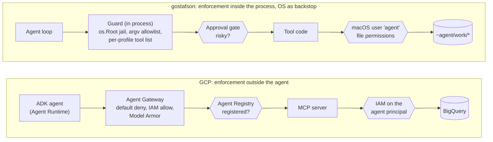

# gostafson vs. the GCP agent reference architecture

Status: draft, 2026-11-12
Compares gostafson with the companion [GCP agent reference architecture](https://github.com/ahplummer/gcp-agent-reference-architecture): one ADK agent on Google's Agent Runtime, answering from BigQuery through a managed MCP server, governed by Agent Identity, Agent Gateway, Agent Registry and Model Armor.

Both projects deal with the same concerns: which model runs, what the agent may touch, who approves risky actions, what gets logged, what it costs. They differ in who owns each piece and where the rules are enforced.

---

## 1. Summary

| | GCP reference architecture | gostafson |
|---|---|---|
| Purpose | An enterprise archetype: the standard shape every team's agent copies | One person's agent on one Mac |
| Scale | Many agents, many teams, many tools | One agent, one user, a handful of tools |
| Who builds the governance | Google, as managed services you configure | You, as code in the harness plus OS settings |
| Where rules are enforced | Outside the agent process: gateway, IAM, registry | Inside the process (guard, router) plus the OS user boundary |
| Main threats | Tool sprawl, data exfiltration across systems, unapproved MCP servers, audit and compliance | Prompt injection triggering file or command access; local data leaving the machine |
| Models | Gemini by default; Claude and others via Model Garden under Google's terms | Local models by default; cloud models via OpenRouter only on request |
| Cost shape | Pay per use for runtime, gateway, tokens; budget alerts | Local inference free; OpenRouter tokens with a credit limit |
| Defined in | Terraform plus the ADK CLI | Go code, one TOML config, `setup.sh`, Makefile |
| Status (2026-11-12) | Terraform baseline (APIs, bucket, dataset, IAM, budget); agent not deployed yet | M4 done and deployed: CLI, web page, Telegram and White Noise; tag routing, sessions, file tools, guard, audit log, cloud profile rules, approval gate |

---

## 2. Where enforcement happens

The largest architectural difference. In GCP, the agent can be buggy or compromised and the control plane still blocks it, because the checks run in separate services. In gostafson, the first line of defense is code in the same process as the agent loop; the OS user boundary is the backstop.

| Layer | GCP | gostafson |
|---|---|---|
| Policy decision | Agent Gateway checks the registry and IAM for each call | The guard checks the profile's tool list, path roots and allowlist |
| Hard boundary | IAM on the agent's principal: the dataset is read-only no matter what the agent sends | macOS file permissions on the `agent` user: your home is unreadable no matter what the guard allows |
| Content inspection | Model Armor scans prompts and tool responses | None. A decision model could score risk later, as advice only (reference architecture section 6) |
| Human approval | ADK tool confirmation | Approval gate over the transport: `write_file` over an existing file asks y/N, times out to no |

What this means in practice: in GCP a bug in agent code can't reach an unregistered tool. In gostafson a bug in the guard is contained only by the OS user. That's why the guard has the strictest tests and why a failing guard test blocks deploys.

---

## 3. Piece by piece

| Concern | GCP piece | gostafson piece | Analogy holds? | Key difference |
|---|---|---|---|---|
| Front door | Gemini Enterprise app, ADK dev UI, REST | Transport adapter: CLI now, a messenger later | Yes | GCP authenticates users through the identity provider; gostafson trusts whoever controls the CLI or the messenger account |
| Runtime | Agent Runtime (managed, serverless) | LaunchDaemon on one Mac | Yes | Managed scaling vs. one always-on process |
| Harness / agent loop | ADK `LlmAgent` and runner | `internal/loop`, ~100 lines | Yes | Framework vs. hand-written; ADK adds callbacks, sub-agents, evals |
| Model access | Model Garden; Gemini native, Claude via adapter | `internal/client` against Ollama, LM Studio, OpenRouter | Yes | GCP keeps all calls under Google's terms and billing; gostafson sends cloud calls to a broker under each provider's terms |
| Model choice | `AGENT_MODEL` env var at deploy; router agent or `before_model_callback` per request | Profiles in config; `@tag` per message; decision model later | Partly | GCP chooses per deployment; gostafson lets the user choose per message |
| Sessions | Agent Platform Sessions | SQLite per chat (`internal/sessions`) | Yes | Same idea: raw history keyed by conversation |
| Memory across chats | Memory Bank | None (non-goal for now) | No | |
| Tools | MCP servers (Google-managed or custom) | In-process Go functions | Partly | MCP is a network protocol with its own server; gostafson's tools run inside the binary |
| Tool catalog | Agent Registry | Tool registry + per-profile tool list in config | Partly | GCP's registry is shared across agents and checked by the gateway; gostafson's is a list in one process |
| Egress control | Agent Gateway, default deny | Cloud profiles get no file tools; `fetch_url` optional; local servers bound to localhost | Partly | Network-level vs. "the tool doesn't exist for that profile" |
| Identity | Agent Identity: per-agent principal, no keys | Dedicated macOS user `agent`; binary owned by admin | Yes | Both give the agent its own identity that permissions attach to. A redeploy changes GCP's principal; the macOS user never changes |
| Least privilege | IAM roles, `bigquery.dataViewer` on one dataset | `os.Root` jails per profile, argv allowlist | Yes | Declarative IAM vs. code plus OS permissions |
| Content safety | Model Armor templates | None in v1 | No | Local models and opt-in cloud lower the exfiltration risk; prompt injection is still open |
| Human in the loop | ADK tool confirmation | Approval gate, yes/no over the transport, times out to no | Yes | |
| Observability | Cloud Trace / Logging / Monitoring via OpenTelemetry | JSONL audit log with trace and span IDs (M2) | Yes | Central platform vs. one file. Both contain prompts, so both are sensitive |
| Evals | `adk eval` / Agent Platform Evals, golden set | `evals/` golden set, Python runner (M5) | Yes | |
| Secrets | No keys: Agent Identity and IAM | OpenRouter key in Bitwarden; env var (dev) or `0600` file (host) | Partly | GCP avoids long-lived keys entirely; gostafson has one limited key |
| Cost control | Labels, billing budget alerts at $25 / $50 | OpenRouter credit limit; local inference free | Yes | |
| Infrastructure as code | Terraform (APIs, IAM, budget); ADK CLI for the agent | `setup.sh`, Makefile, config | Yes | Two Terraform passes because the agent principal exists only after deploy; gostafson's `agent` user exists before deploy |
| Deployment | ADK CLI deploy; new principal each time | `make deploy`: versioned binary, symlink, restart; `make rollback` | Yes | |
| Multi-agent | Sub-agents, A2A | `delegate()` tool, depth 1 (M7) | Partly | A2A crosses services and clouds; `delegate()` is an in-process call |

---

## 4. What each has that the other doesn't

**Only in GCP, and why gostafson skips it**

| Piece | Why not in gostafson |
|---|---|
| Registry shared across agents | One agent; the config file is the catalog |
| Network gateway for egress | One process on one Mac; tools that don't exist can't be called |
| Model Armor | Possible later; nothing comparable runs locally today without adding a model |
| Memory Bank | Non-goal for v1 |
| Central telemetry and per-agent cost attribution | One user, one log file |
| Keyless identity | OpenRouter needs an API key; local servers need none |

**Only in gostafson, and whether GCP could use it**

| Piece | In GCP terms |
|---|---|
| User picks the model per message (`@tag`) | Possible with a `before_model_callback` reading a prefix; unusual in enterprise, where the platform team picks models |
| Local inference by default; data stays on the machine | The closest is VPC Service Controls plus regional endpoints; the data still leaves your hardware |
| Decision model for routing with a confidence threshold | Same pattern would work as a router step in ADK |
| Approval prompts on a phone | Gemini Enterprise has its own confirmation UI; a messenger channel would be custom |
| One binary, rollback in one command | Agent Runtime redeploys; rollback means redeploying the old version and redoing IAM for the new principal |

---

## 5. Ideas that could cross over

**From GCP into gostafson**
- **Default deny as a written rule.** Adopted in M2 (PRD D18): an unlisted or unknown tool name is rejected and logged, never passed through.
- **OpenTelemetry-shaped audit records.** Adopted in M2: JSONL with a trace ID per turn and a span per tool call. Subagent transcripts nest naturally, and the log could be exported to a tracing UI later.
- **Registry for MCP servers, if gostafson ever calls external MCP servers.** An allowlist of server URLs in config, checked by the guard, would be the local equivalent of Agent Registry plus Gateway.
- **Golden-set evals as a deploy gate**, not just a comparison tool, matching "evals become a CI/CD gate" in the GCP doc.

**From gostafson into the GCP archetype**
- **Approval timeouts that default to no.** Worth stating explicitly in the archetype's human-in-the-loop standard.
- **Cloud models get no tools that read internal data unless explicitly allowed.** The same idea as gostafson's "cloud profiles get no file tools," applied to partner models in Model Garden.
- **A confidence threshold before routing to a more capable or more expensive model.** Fits the per-request routing question in the GCP doc's model choice row.

---

## 6. Takeaway

Same concerns, different ownership. GCP buys a control plane and configures it; gostafson writes a small one and leans on the operating system for the hard boundary. For learning, the two projects cover each other's gaps: GCP shows what governance looks like when it's a separate service, and gostafson shows the same controls as code you can read in one sitting.
