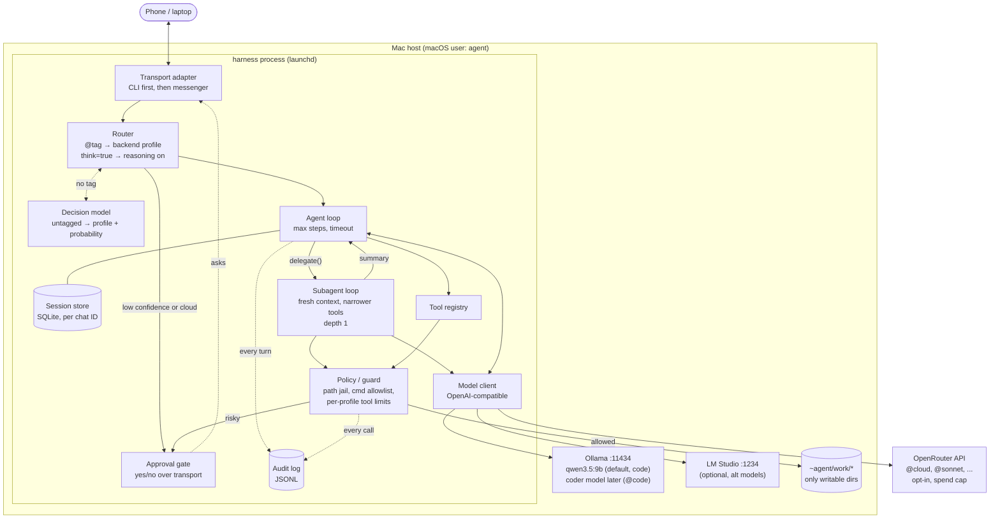

# gostafson: Reference Architecture

Status: draft, 2026-11-12
Purpose: build a small, local-first agent harness on a single Mac (reference host: Mac mini M4 Pro, 24 GB unified memory): local models by default, a per-turn prefix to switch models, an optional cloud model, remote access over a messenger, and tight limits on what the agent can touch.
Out of scope: multi-user access, Gastown-style multi-agent orchestration (section 7 explains where the line is), long-term memory (later, maybe).

Companion: the gcp-harness project covers the same governance ideas (scoped identity, egress control, audit, budget) on Google's managed stack. Section 8 maps one to the other.

---

## 1. Terms

| Term | Meaning here |
|---|---|
| **Harness** | The whole program around the model: transport, router, agent loop, tools, policy, logging, config. The model is a stateless text-in/text-out function; the harness makes it an agent. |
| **Transport adapter** | Receives messages from a channel (messenger, CLI) and sends replies back. Hermes calls this layer the gateway; other projects say channel or connector. |
| **Session** | One conversation's message history, keyed by chat/thread ID. |
| **Router** | Per-message dispatch before the loop: reads the `@tag` prefix, picks a backend profile, strips the tag. A local profile's tag sticks for the chat; a cloud profile's tag lasts one message (PRD D32) unless the profile has `sticky = true` (D33), and then every reply starts with `[profile]`. Tags and sticky profiles always win; untagged messages in chats on `default` go to the decision model (section 6). |
| **Decision model** | A small non-generative model that answers typed questions (pick one of N options, score, yes/no) with a probability per option in one forward pass. Jev (TypeSafe's "System One" API) is the reference; Laya, kev and mlx-decision are open reproductions. |
| **Subagent** | A second agent loop started by the first, with a fresh context, its own profile and a narrower tool set. Returns a summary to the parent. |
| **Delegation depth** | How many levels of subagents may nest. Here: 1. |
| **Backend profile** | A named bundle: endpoint, model name, sampling settings, which tools it may use. `default`, `code`, `cloud`, etc. |
| **Model client** | The one HTTP client that talks to every backend. Ollama, LM Studio and OpenRouter all speak the OpenAI Chat Completions API, so one client covers all three. |
| **Agent loop** | Call the model; if it asks for tools, run them and call again; stop when it answers in plain text or hits the step limit. |
| **Tool registry** | The list of tools with their JSON schemas, sent to the model on each call. |
| **Policy / guard** | Checks every tool call before it runs: path jail, command allowlist, network rules, per-profile tool limits. |
| **Approval gate** | For tools marked risky, the harness asks you over the transport ("run `npm install`? yes/no") and waits. Human-in-the-loop. |
| **Audit log** | Append-only JSONL: one line per turn and per tool call. |
| **Supervisor** | Keeps the harness running: a `launchd` daemon on macOS that runs as the `agent` user. |
| **Setup script** | `setup.sh`: creates the service user and directories, pulls models, writes config, optional cloud key step. |

**Related projects**

| Name | What it is | Our equivalent |
|---|---|---|
| Marmot | E2EE group messaging protocol: MLS over Nostr relays | Candidate transport |
| White Noise | Messenger app built on Marmot | Candidate client on your phone |
| Maple | Maple AI (OpenSecret): hosted LLM inside confidential-compute enclaves, OpenAI-compatible API | OpenRouter (see section 4) |
| OpenClaw | A large open-source personal agent | What this is meant to be smaller than |

---

## 2. Architecture



**One message, end to end**

1. The transport adapter receives `@code add a dark mode toggle to nav.html` from chat `X`.
2. The router matches `@code`, selects the `code` profile, and passes on `add a dark mode toggle to nav.html`.
3. The agent loop loads chat `X`'s history, adds the message, and calls the model client with the `code` profile's endpoint, model and tool list.
4. The model returns tool calls (`read_file`, then `write_file`). For each one, the guard checks the path against the jail; `write_file` is allowed inside `~agent/work/napps`, so it runs. The result goes back to the model.
5. The model answers in plain text. The loop saves the history, writes the audit line, and the adapter sends the reply.
6. A local tag sticks: the next message without a prefix goes to the same profile until another tag, `@default` or `/reset`. A cloud tag lasts one message, and the chat goes back to its local profile, unless that cloud profile has `sticky = true` (PRD D33). In a chat on `default`, an untagged message will be routed by the decision model (section 6) once that's built.

---

## 3. Components

| Piece | Choice | Why | Notes |
|---|---|---|---|
| Language | Go, pinned to 1.27.4 in `.tool-versions` (1.24+ needed for `os.Root`) | `os.Root` for the path jail in the standard library; one static binary; goroutines for concurrent chats, approvals and subagents; small dependency tree for a public repo | Evals and labeling scripts stay in Python under `evals/` and never ship in the binary |
| Concurrency | One goroutine per chat; `context.Context` carries the turn timeout to the model call, tools and subagents | An approval wait in one chat doesn't block others; cancel stops everything under the turn | Local model calls still go through one at a time (memory, section 4) |
| Model client | Hand-written chat completions client on `net/http` (`internal/client`), one per profile base URL | Ollama (`/v1`), LM Studio (`/v1`), OpenRouter (`https://openrouter.ai/api/v1`) all accept it; `openai-go` v3 would pull in the Azure and AWS SDKs (PRD D12) | No LangChain or agent framework: the loop is about 100 lines |
| Agent loop | Hand-written: max 8 tool steps, 120 s wall clock per turn | Easy to read and test; nothing hidden | Stop and report on limit, don't silently truncate |
| Router | Prefix table in config: `@code→code`, `@cloud→cloud`, `@sonnet→sonnet` (one tag per cloud model); no tag → decision model | Tags are predictable and user-controlled; the decision model handles the untagged case | Profiles with `think_toggle` send `reasoning_effort: "none"` unless the message has `think=true` |
| Decision model | Behind a `decide(state, options) → {option: prob}` interface; mlx-decision serving `pplx-decider-flash-v1.2` (4-bit) on the host, Jev's `/v1/systemone` API | ~200 ms on a short message, 2.8 GB, gives a probability per option; tested on the host (section 6) | Section 6 |
| Subagents | `delegate(profile, task)` tool that calls the loop again | Keeps the parent's context small | Section 7 |
| Session store | SQLite via `modernc.org/sqlite` (no cgo, keeps the binary static), one row per message, keyed by chat ID | Survives restarts; easy to inspect | Keep last N turns in context; `/reset` command clears |
| Tools (v1) | `list_dir`, `read_file`, `write_file`, `search_files`, `fetch_url` (GET only, optional) | Enough for web dev on napps | No shell tool in v1 |
| Tools | `run` with a fixed command list (PRD D31): read-only `ls`, `tree`, `wc`, `head`, `tail`, `diff`, `grep`, `rg`, `find`, `file`, `du`, `jq`, `node --check`, `mkdir`, `git status/diff/log/show`; `rm`, `mv`, `cp`, `git init/add/commit` ask first | Inspect, check and version a project without a general shell | `exec.CommandContext` under `sandbox-exec` (no network, writes only in the root, nothing readable under `/Users` but the root), argv only, per-command flag lists, fixed program paths, scrubbed environment, 30 s limit, process group killed |
| Images | One path for every transport: `internal/media` checks, scales with `sips` (1,568 px) and keeps the chat's latest image for follow-ups; sent as `image_url` parts; cloud profiles only get images sent with their message (PRD D34) | Screenshots and photos from the phone or the CLI | Vision support asked of Ollama or OpenRouter on first use |
| Path jail | Each root opened as an `os.Root`; all file tools go through it, so `..` and symlinks can't escape | Directory confinement at the app level, without hand-written path checks or check-then-open races | Roots per profile: `code` gets `~agent/work/napps`, `default` gets `~agent/work/notes` |
| OS-level confinement | Run as a separate macOS user `agent` with its own home; no sudo; your home not readable | If the guard has a bug, the OS still blocks access to your files | The local equivalent of a per-agent identity. `sandbox-exec` profile as an extra layer (deprecated by Apple, still works) |
| Cloud data rule | Remote profiles get no file tools by default and text-only history (tool calls and results dropped); OpenRouter requests send `provider.data_collection: "deny"`; `default_profile` must be local | Local file contents never leave the host unless you paste them in or tag a cloud profile after a reply that quoted them | `allow_remote_file_tools = true` per profile to override; `zdr = true` in `provider` for zero data retention. PRD D21 |
| Approval gate | `internal/approve`: a tool's `Confirm` returns a question; the guard asks over the transport (`[y/N]`), anything but yes or no answer within `approval.timeout` is a deny, logged with `approval` | Human-in-the-loop. Now: `write_file` over an existing file, with the size change (PRD D22). Later: unlisted commands (M5) | Same idea as ADK tool confirmation in gcp-harness. CLI answers come from the same input stream; the CLI handles one message at a time |
| Audit | JSONL in `~agent/logs/`: timestamp, chat, profile, model, tokens, tool, args, decision, duration | Answers "what did it do and why" | Logs contain prompts; keep them on the host |
| Supervisor | `launchd` LaunchDaemon in `/Library/LaunchDaemons` with `UserName=agent`, `KeepAlive` on | Starts at boot and restarts on crash without anyone logged in as `agent` (a LaunchAgent would need a GUI login) | `sudo launchctl kickstart -k system/com.gostafson.agent` to restart |
| Config | One `config.toml`: profiles, prefixes, roots, allowlist, transport, limits | Changing models or rules is a config edit | Keys per profile from an environment variable (`api_key_env`, dev) or a `0600` secrets file (`api_key`, host); see section 10 |
| Setup | `setup.sh`: create user and dirs, `go build` and install the binary, `ollama pull`, write config, optional OpenRouter step, install LaunchDaemon | One command to stand it up on a clean Mac | Optional cloud setup, off unless chosen |

---

## 4. Models and memory budget

| Profile | Prefix | Backend | Model | Approx. RAM (Q4) |
|---|---|---|---|---|
| default | none | Ollama | `qwen3.5:9b`, thinking off unless `think=true` | ~6.6 GB |
| code | `@code` | Ollama | `qwen3.5:9b` for now; M5 evals compare `qwen3-coder:30b` (MoE, 3B active) and `qwen2.5-coder:14b` | ~6.6 GB now; ~18 GB / ~9 GB |
| cloud | `@cloud` | OpenRouter | a general model slug of your choice | 0 |
| sonnet | `@sonnet` | OpenRouter | `anthropic/claude-sonnet-5.5` | 0 |
| opus | `@opus` | OpenRouter | `anthropic/claude-opus-5.5` | 0 |
| fable | `@fable` | OpenRouter | `anthropic/claude-fable-5.2` | 0 |
| kimi | `@kimi` | OpenRouter | `moonshotai/kimi-k3` | 0 |
| luna | `@luna` | OpenRouter | `openai/gpt-5.6-luna` | 0 |

- **GPU memory on 24 GB:** macOS lets the GPU wire about 16–18 GB by default. `qwen3.5:9b` plus `qwen2.5-coder:14b` fit together. `qwen3-coder:30b` doesn't fit next to the 9B; Ollama unloads one to load the other (set `keep_alive`), so the first `@code` turn after a default turn takes a few seconds longer.
- **Tool calling:** the loop depends on the model emitting proper tool calls. Qwen3.5, Qwen3 and Qwen3-Coder do this in Ollama; `qwen2.5-coder` has been unreliable at it. Test each model with the same small golden set before settling.
- **Context length:** Ollama loads models at 4096 tokens by default, and its `/v1` API can't change that per request. `make models` creates `gostafson-qwen3.5-9b` with `num_ctx` 32768 (9.7 GB loaded, vs 9.1 GB at 16K). PRD D15.

**OpenRouter in place of Maple**

OpenRouter replaces Maple in the architecture: same API shape, one key, any model. The privacy property is different:

- Maple runs the model inside attested enclaves, so the operator can't read your prompts.
- OpenRouter is a broker. Prompts go to OpenRouter and then to the upstream provider, under that provider's data policy.

To narrow that gap:
- Set the per-request provider preferences to exclude providers that log or train on data (`provider.data_collection: "deny"`, and zero-data-retention routing if available on your account).
- Keep file tools off for cloud profiles (section 3).
- Set a credit limit on the OpenRouter key.

If enclave-level privacy matters for some turns, Maple can be added later as one more profile; it's one more `base_url`.

---

## 5. Transport options

Chosen (PRD D23): CLI, a web page on the tailnet, Telegram, and White Noise, any combination at once. Chat IDs carry a transport prefix, chats run in parallel, and an approval goes back over the transport its message came from. Status: all four built; White Noise and Telegram tested against fake servers so far.

| Transport | Fit | Effort | Notes |
|---|---|---|---|
| CLI / SSH | Development, and remote use over Tailscale | Lowest | Always keep it as a debug path |
| White Noise (Marmot) | E2EE, no phone number, no central server | Unknown | Needs a headless Marmot client the harness can drive (Rust MDK / whitenoise libraries, or a CLI if one exists). Verify maturity before committing. |
| Signal (`signal-cli`) | E2EE, mature bot tooling | Low–medium | Needs a second phone number for the bot account |
| Telegram bot | Easiest bot API | Low | Not E2EE for bots; messages pass through Telegram's servers |
| Web UI on Tailscale | Private to your tailnet | Medium | No messenger needed; the phone uses the Tailscale app |

The interface is `Name`, `Receive`, `Send`, plus optional `Ask` (approvals), `Busy` (spinner or "typing…") and `Sequential` (the CLI, whose next input line may be an approval answer). Asynchronous transports use a small `Pending` helper: while a question is open in a chat, that chat's next message answers it instead of starting a turn.

---

## 6. Decision model

A decision model answers typed questions about a block of text (the "state") with a probability per option, in one forward pass and without generating text. TypeSafe's Jev / System One API defined the shape; https://mrjev.com/projects/category/open-source/ lists over a hundred open reproductions (as of 2026-11-12).

**Routing untagged messages**

```
route(text):
    if text starts with @tag:
        return profile_for(tag)                        # tags always win
    p = decide(first 300 chars of text, options)      # the new message only, never history
    if p.top == "cloud" or p.top_prob < THRESHOLD:     # start at 0.7, tune on the golden set
        ask over transport: "looks like @<p.top>, send it?"
    return p.top
```

Rules:
- **Never auto-route to a cloud profile.** That is the decision that sends data off the host, so it stays with you: either you type the tag or you answer yes to the prompt.
- **Log the decision.** The audit line records `routed_by: tag | decision`, the label, and its probability. That shows whether the decision model is worth keeping compared with "no tag means default".
- **Fail closed.** If the decision server is down or slow (over 500 ms), route to `default`.
- **Describe the options.** Each option gets a one-line description, kept in config next to its profile. Bare names don't work: in the test below, "summarize this week's AI news" went to `default` at 0.96 without descriptions and to `cloud` at 0.96 with them.
- **Keep the input short.** Time grows with input length (table below), so send only the new message, cut to a few hundred characters, and keep descriptions to one line each.

**Chosen: mlx-decision with `pplx-decider-flash-v1.2`, 4-bit** (PRD D20)

mlx-decision (armbues) runs decision models on MLX and serves Jev's `/v1/systemone` API (`mlx-decision server -m <model> --port 8000 --api-key <key>`; localhost by default; one request at a time). `pplx-decider-flash-v1.2` is Perplexity's 4B model distilled from their 27B. mlx-decision's README puts it level with hosted Jev on classification (TREC 93.6 vs 92.8) and behind on entailment (ANLI 61.8 vs 70.2), which routing doesn't use.

Install on the host: `uv tool install --python 3.13 mlx-decision`, then `mlx-decision download perplexity-ai/pplx-decider-flash-v1.2 --bits 4 --local-dir ~/Models/pplx-decider-flash-v1.2-4bit`.

Tested on the host, 2026-11-12 (nine hand-written messages, options with descriptions):

| | 8-bit | 4-bit |
|---|---|---|
| Size | 4.8 GB | 2.8 GB |
| Routed as expected | 9/9 | 9/9, same picks, probabilities within 0.03 |
| Time per call (messages of 5–15 words, ~80 tokens of descriptions) | 276 ms | 275 ms |

| Input (4-bit, short descriptions) | Time |
|---|---|
| 8 words | 184 ms |
| 400 words | 725 ms |
| 3,200 words | 4.9 s |
| 12,000 words | 20.7 s |

Findings: quantization costs nothing here, so 4-bit; time comes from input length, not model size or GPU sharing; the model is over-confident ("make this paragraph friendlier" scored 0.99 for `default`; only one message of nine came in under 0.9), so the threshold catches little and the always-ask rule for cloud carries the safety. Nine messages are not an evaluation: M6 still labels 50–100 real messages from the audit log.

**Other candidates** (from mrjev.com reviews; not run here)

| Project | Fit | Caveat |
|---|---|---|
| Laya (NandhaKishorM), Laya MPS fork for Metal | 421M ModernBERT English model, 49–136 ms warm on CPU, Apache-2.0 | English only; ships over-confident, so tune the threshold |
| kev-0.5b (jaredpalmer) | Qwen base + LoRA, `uv run` server, tagged v0.1.0 | Larger sizes are previews; accepts any API key, so bind to localhost |
| ollaya | Ollama-style pull/serve for decision models | Reviewed build is Linux x86_64; check for macOS |

Memory: the 4-bit pplx-flash (2.8 GB) plus `gostafson-qwen3.5-9b` at 32K (9.7 GB) is about 12.5 GB, inside the host's ~16 GB GPU limit if Hermes isn't holding a model at the same time.

**Other uses, later**
- **Approval pre-check:** score how risky a tool call looks and only ask you above a threshold. The deterministic guard (path jail, allowlist) still enforces; the score only decides whether to ask about things the guard already allows.
- **Loop control:** "is the task done?", "should this be delegated?" as choice questions.

**Maturity:** these projects are about two months old, and the directory includes at least one repackaged copy with broken installs (DeepOpen). Pin versions and keep everything behind `decide()` so the implementation can be swapped.

---

## 7. Subagents and orchestration

The plumbing is ordinary: a nested function call, a job queue with workers, or a supervisor with a shared ledger. What differs from normal distributed systems is the worker:

- Work is described in plain English and split at runtime, often by a model.
- Workers are nondeterministic, so a retry can take a different path and touch different files.
- Failures look like success: a confident, well-formed wrong answer. Output needs verification (tests, a reviewer, or you).
- The scarce resource is the context window. Subagents exist mainly to keep each context small; on a 24 GB host, parallel speed is limited by memory anyway (section 4).
- Agents editing the same files conflict in meaning, not just bytes. Separate work directories or git worktrees, then a merge step.

**Levels**

| Level | Pattern | Process model | In this harness |
|---|---|---|---|
| 1. Subagent as tool | Nested function call | One process, parent waits | **Yes (v1)** |
| 2. Task queue + workers | Job queue / worker pool | Worker pool, queue in SQLite | Maybe later: async tasks with status and cancel over the transport |
| 3. Gastown-style | Supervisor tree + shared work ledger (Beads in git), one worktree per agent | Many long-lived processes | No. A separate system that could drive this harness as one of its agents |

**Level 1 design**

```
delegate(profile, task, tools []string) -> summary
```

- Starts `loop()` with a fresh message list: a subagent system prompt plus `task`. No parent history.
- **Policy only narrows:** the child's path roots and tool list must be subsets of the parent's. An empty tool list means read-only file tools. A cloud profile child gets no file tools, same as section 3.
- **Depth 1:** the `delegate` tool isn't given to children.
- **Limits:** its own step limit (8) and timeout, counted inside the parent's turn timeout.
- **Approval:** delegating to a cloud profile goes through the approval gate.
- **Return:** a summary capped at about 2K tokens. The full child transcript goes to the audit log under the parent's turn ID with a `subagent_id`.
- **Concurrency:** one child at a time for local profiles (memory); cloud children could run in parallel later.

**Typical uses:** `@code` parent delegates "read these five files and summarize the nav structure" to a read-only child; default parent delegates a hard question to `cloud` after approval.

---

## 8. Mapping to gcp-harness and Hermes

A longer comparison with the GCP architecture, including where each enforces its rules, is in [gcp-comparison.md](gcp-comparison.md).

| Concern | gcp-harness | Hermes Agent | gostafson |
|---|---|---|---|
| Front door | Gemini Enterprise / ADK UI | Gateway (Telegram, Discord, Signal, ...) | Transport adapter |
| Model choice | `AGENT_MODEL` env var, Model Garden | Configured provider/model | Router + backend profiles + decision model |
| Subagents | ADK sub-agents / A2A | Subagent delegation | `delegate()` tool, depth 1, policy only narrows |
| Agent loop | ADK `LlmAgent` | Hermes core loop | Hand-written loop |
| Identity | Agent Identity principal | Your user account | Dedicated macOS user `agent` |
| Tool allowlist | Agent Registry + Gateway, default deny | Toolsets enabled in config | Tool registry + per-profile tool list |
| Egress control | Agent Gateway | Mostly open | Cloud profiles get no file tools; `fetch_url` optional |
| Content safety | Model Armor | None by default | None in v1 (local models; cloud is opt-in) |
| Human-in-the-loop | ADK tool confirmation | Command approval prompts | Approval gate |
| Execution sandbox | Managed runtime | Terminal backends (local, Docker, SSH, ...) | Path jail + argv allowlist + `sandbox-exec` + OS user |
| Audit | Cloud Trace / Logging | Session logs | JSONL audit log |
| Budget | Billing budget alerts | Provider-side | OpenRouter credit limit; local is free |
| Memory across chats | Memory Bank | Memory files, skills | Out of scope for v1 |

The point of building our own (option a) is the last column: every row is a piece of code you wrote and can read, instead of a feature you configured.

---

## 9. Repository layout (proposed)

```
gostafson/
├── docs/
│   ├── PRD.md
│   └── reference-architecture.md
├── Makefile             # build, test, run, tunnel, deploy, rollback (section 10)
├── Makefile.local       # gitignored: DEPLOY_HOST
├── setup.sh
├── config.example.toml
├── go.mod
├── cmd/gostafson/main.go  # wiring, startup, shutdown
├── internal/
│   ├── config/          # TOML config; keys from env vars or a 0600 secrets file
│   ├── transport/       # Transport interface; cli.go (+ style.go), web.go (+ webpage/), telegram.go, whitenoise.go
│   ├── router/
│   ├── decide/          # decision model client, behind Decide()
│   ├── loop/
│   ├── client/          # chat completions client on net/http
│   ├── tools/           # fs.go (M2); run.go, fetch.go, delegate.go later
│   ├── guard/           # default deny, path checks, os.Root per profile, audit per call; argv allowlist and narrowing later
│   ├── approve/         # yes/no gate with timeout
│   ├── sessions/        # SQLite (modernc.org/sqlite)
│   └── audit/           # JSONL writer, trace and span IDs
├── launchd/com.gostafson.agent.plist
└── evals/               # Python: golden.jsonl, runner, labeling scripts (not shipped)
```

---

## 10. Development and deployment

**Day-to-day: run locally, use the host's models.** Most work doesn't need a deploy. Run the harness on the dev Mac with the CLI transport and reach the host's Ollama and LM Studio through an SSH tunnel:

```sh
make tunnel            # ssh -N -L $TUNNEL_OLLAMA_PORT:localhost:11434 -L $TUNNEL_LMS_PORT:localhost:1234 $DEPLOY_HOST
make run               # go run ./cmd/gostafson -config config.local.toml
make test-integration  # unit tests plus tests that call the host's Ollama
```

The tunnel's local ports default to 11434 and 1234. If the dev Mac runs its own Ollama, set `TUNNEL_OLLAMA_PORT` (e.g. 21434) in `Makefile.local` and point `config.local.toml` at it. Ollama stays bound to localhost on the host; it has no authentication, so it shouldn't listen on the LAN.

**Build.** Cross-compile on the dev Mac:

```sh
CGO_ENABLED=0 GOOS=darwin GOARCH=arm64 go build -trimpath \
  -ldflags "-s -w -X main.version=$(git describe --always --dirty)" \
  -o dist/gostafson ./cmd/gostafson
```

`modernc.org/sqlite` needs no cgo, so this is a plain cross-build. Go signs darwin/arm64 binaries ad hoc when it builds them, and `scp` doesn't set the quarantine attribute, so the copied binary runs as is.

**Install layout on the host**

```
/usr/local/libexec/gostafson/   owned by the admin account, not agent
├── gostafson-3f2a1c9                  one file per deploy, named by git SHA
├── gostafson-8b7e002
├── current -> gostafson-8b7e002       com.gostafson.agent runs this path
└── wn-agent                           copied by setup.sh; com.gostafson.wn-agent runs it
/usr/local/etc/gostafson/config.toml   owned by root, mode 644 (make push-config)
/Library/LaunchDaemons/com.gostafson.{agent,wn-agent}.plist   both run as agent
/Users/agent/                          mode 700, owned by agent
├── secrets.toml                       mode 600 (make push-secrets)
├── work/napps/                        @code's root
├── var/sessions.db
├── logs/audit.jsonl, gostafson.log, wn-agent.log
└── .marmot-agents/gostafson/          the White Noise account (wn-agent --home)
```

The `agent` user can execute the binaries and read its config, but can't modify either, so a tool bug can't widen the agent's own permissions. The admin's home is mode 750, so `agent` can't read it.

**Deploy and rollback**

| Target | Does |
|---|---|
| `make test` | `go vet`, `go test` |
| `make deploy` | Checks `DEPLOY_HOST`, runs tests, builds, copies `gostafson-<sha>` (to a temporary name, then renamed), switches `current`, restarts the daemon and waits until the same pid is seen twice, keeping the newest 5 only once it runs. macOS refuses the first launch of each new build (AMFI "Launch Constraint Violation"; launchd drops the job) until Background Task Management refreshes its record about 10 s later; deploy loads the job again if it was dropped, and fails after 30 s if it still isn't running |
| `make rollback` | Points `current` at the version deployed before the current one, restarts |
| `make versions` | Lists deployed versions and what `current` points to |
| `make logs` | Tails the audit log on the host (with sudo: only `agent` can read it) |
| `make setup` | Copies `deploy/` to the host and runs `setup.sh` with sudo |
| `make push-config` | Installs `config.host.toml` as the host config; refuses while values in angle brackets remain |
| `make service-status` / `make service-log` | launchd state of both daemons / their stderr logs |

A failing test blocks the deploy, which matters most for the guard tests. Restarts use `sudo launchctl kickstart -k system/com.gostafson.agent`. A sudoers rule allowing just that command without a password keeps deploys non-interactive.

**One-time setup on the host** (`make setup`, which runs `deploy/setup.sh` there with sudo; safe to re-run): create the hidden `agent` user and group (no password, shell `/usr/bin/false`) and its directories; create `/usr/local/libexec/gostafson` (admin-owned) and `/usr/local/etc/gostafson` (root-owned); copy `wn-agent`; move gostafson's White Noise account from the admin's home into `/Users/agent` with `wn-agent` stopped (the old directory is renamed, not deleted); install and load both LaunchDaemons; add a sudoers rule letting the admin restart and start `com.gostafson.agent` without a password. Models are created with `make models`.

**Config** for the host is written on the dev Mac as `config.host.toml` (gitignored; template `config.host.example.toml`, absolute paths) and installed with `make push-config` as `/usr/local/etc/gostafson/config.toml`, owned by root. Deploys never touch it. Changes take effect on restart. PRD D28.

**Secrets.** Bitwarden Secrets Manager holds the OpenRouter key; gostafson never calls Bitwarden itself (PRD D14).

| Where | How the key arrives | Config |
|---|---|---|
| Dev Mac | `bwset OPENROUTER_API_KEY` (bw-flow shell functions) puts it in the shell's environment; nothing on disk | `api_key_env = "OPENROUTER_API_KEY"` |
| Host | `bwset` each of `OPENROUTER_API_KEY`, `GOSTAFSON_TELEGRAM_TOKEN`, `GOSTAFSON_WEB_TOKEN` on the dev Mac, then `make push-secrets`: whichever are set go over SSH stdin to `/Users/agent/secrets.toml` (replacing it), owner `agent`, mode `0600` | `secrets_file = "/Users/agent/secrets.toml"`; `api_key = "openrouter"`, `token = "telegram_token"`, `token = "web_token"` |

To rotate: change the key in Bitwarden, `bwset` again, `make push-secrets`, restart. The daemon doesn't fetch from Bitwarden at boot because the `agent` user has no unlocked keychain, and storing a `bws` access token on the host would expose every secret its machine account can read. If an environment variable is unset, that profile reports itself unavailable and the others keep working.

**Host names stay out of the repo.** The Makefile reads `DEPLOY_HOST` from `Makefile.local`, which is gitignored, and refuses to deploy without it.

**CI (once code exists):** GitHub Actions on `macos-latest` (arm64) running `go vet`, `go test` and `govulncheck` on each push. GoReleaser for tagged releases only if other people start using it.

---

## 11. Build plan and open questions

**Step 1.** `setup.sh` part one: `agent` user, directories, `ollama pull`. CLI transport, router, client, loop, no tools. Prefix switching and `think=true` working.
**Step 2.** File tools, path jail, audit log. `@code` editing a napp in `~agent/work/napps`.
**Step 3.** OpenRouter profiles with the no-file-tools rule and provider data settings. Approval gate on the CLI.
**Step 4.** Pick a messenger and write its adapter. Approval gate over the messenger. `setup.sh` and LaunchDaemon install; first `make deploy`.
**Step 5.** `run` tool with argv allowlist under `sandbox-exec` (done, D31). Golden-set evals per profile (done: `make eval`; `qwen3.5:9b` 42/42, `qwen3:8b` 39/42 but 2.5 times faster).
**Step 6.** Decision model behind `decide()` for untagged messages. Label 50–100 real messages from the audit log, compare against "no tag means default", and set the threshold.
**Step 7.** `delegate()` tool, depth 1, policy-narrowing check with tests.

**Decide**
- Transport: White Noise/Marmot, Signal, Telegram, or Tailscale web UI.
- The credit limit on the OpenRouter key (models: one profile per model, PRD FR-2).

**Verify during the build**
- State of headless Marmot/White Noise tooling a bot can use.
- Ollama tool-call support for each chosen model tag.
- OpenRouter provider-preference fields for data collection and zero data retention on your account.
- GPU wired-memory limit on the host (`sysctl iogpu.wired_limit_mb`) and whether to raise it.
- Whether Hermes and this harness share Ollama cleanly (both loading models at once will contend for memory).
- mlx-decision server latency over HTTP (the tests above called the Python API directly), and memory with Ollama and Hermes both loaded.
- Decision model calibration on real messages; on the test set it was over-confident.
